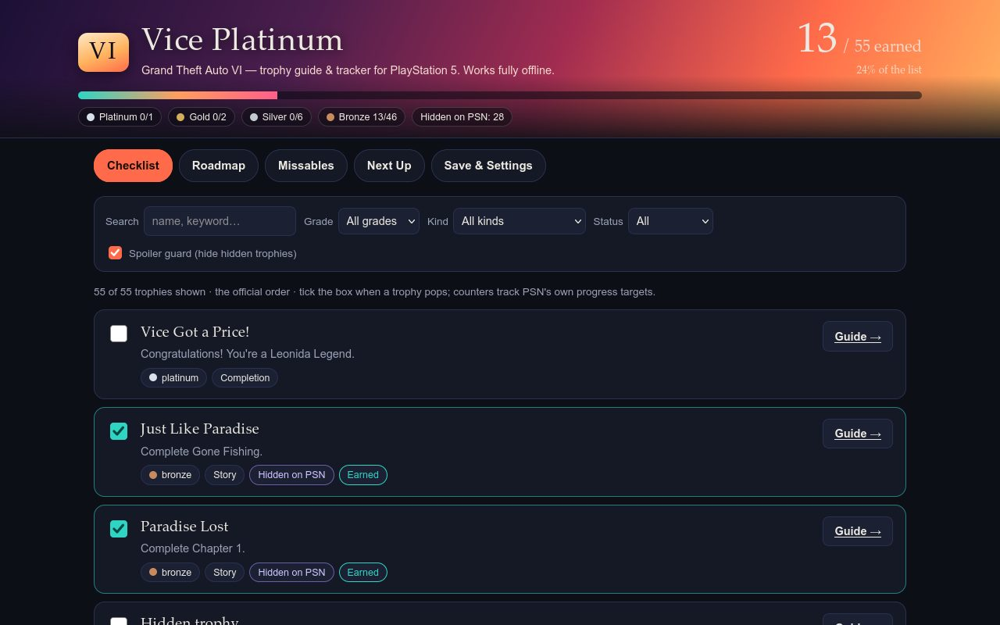

# Vice Platinum — GTA VI Trophy Guide & Tracker

A free, offline trophy guide and tracker for **Grand Theft Auto VI** on PlayStation 5. Open it in a desktop browser and it runs entirely from its own files — no account, no network, no ads.



## What it does

- **All 55 official trophies** — 1 platinum, 2 gold, 6 silver, 46 bronze, 28 of them hidden on PSN — each with its official name, description and grade.
- **Checklist tracker** — tick trophies off as they pop; progress is saved in your browser (localStorage), with **export and import** so you can move or back it up.
- **PSN progress counters** — the 20 trophies PSN itself counts (250 stunts, 42 range golds, $250,000 laundered…) get steppers that fill as you play.
- **Filters and search** — by grade, by kind (Story, Side Missions, Activities, World & Collectibles, Crime & Combat, Money & Property, Moments, Completion) and by earned/remaining.
- **Spoiler guard** — hidden trophies stay masked (no name, no description) until you earn them or choose to reveal them.
- **A guide to every trophy, in our own words** — what to do and when it matters, with the sources for each entry named on its page. Where a trigger was not confirmed at launch, the guide says so instead of inventing one.
- **Roadmap to the platinum** — eight stages built from the official descriptions, with live progress.
- **Missables, honestly** — nothing in the list is confirmed missable; the one community-flagged trophy and the save habits that cover it are spelled out.
- **Next Up planner** — your closest counters, next story steps and one-off moments, computed from your own progress.
- **Personal notes** per trophy, stored locally.

## Run it

The app is plain static files under `app/` — there is no build step.

```sh
node serve.ts          # then open http://localhost:8080
```

Any static file server pointed at `app/` works just as well. Turn your network off: everything still works.

`main.ts` is the entry program for the make.fun competition this was built for: it copies `app/` and `screenshots/` to the output directory and writes the dossier the judges read, using the vendored library in `vendor/` (left byte-for-byte as shipped).

```sh
mkdir -p out && MAKEFUN_OUTPUT_DIR=out node main.ts
```

## Data & sources

- Trophy names, descriptions and grades: the official PlayStation 5 list for Grand Theft Auto VI, frozen 2026-11-18, via [Exophase](https://www.exophase.com/game/grand-theft-auto-vi-psn/trophies/).
- PSN progress targets and hidden flags: via [PSNProfiles](https://psnprofiles.com/trophies/43531-grand-theft-auto-vi), cross-checked against launch-week community lists.
- Guides: written for this app from the official descriptions (`gen-trophies.mjs` holds the text and builds `app/data/trophies.json`). Nothing is copied from another guide.

Fan-made and open source (MIT). Not affiliated with Rockstar Games or Take-Two Interactive; no Rockstar artwork or logos are used anywhere in the app.

## Competition

Built for make.fun's **gta6-trophy-guide-01** ("Build the best GTA 6 trophy guide"). If you found this through make.fun, the referral link is https://make.fun/r/1c94brae.
